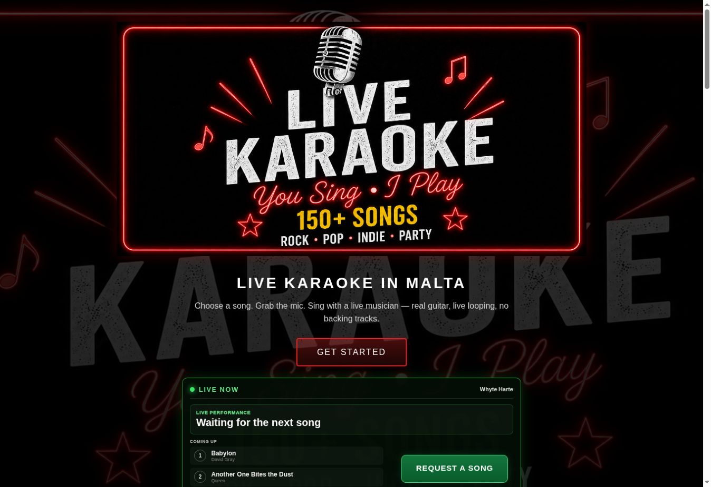

# Continuation after skipping Cloudflare sign-in

Fetched and preserved main `aaa6decd3f9509bf8d022c652b209c19b58031e8`, including
the newer prompter scrolling work. No prompter files were changed in this stage.

## Visible repairs

- Overdue event countdown says **Starting now**, without public lateness wording.
- Request rejection now distinguishes session/QR eligibility from connectivity.
- Existing homepage artwork, green request action, popup, profiles, favourites,
  requests and booking controls remain in place.

## Security implementation added, not activated

- Explicit public live/event/settings projections; no requester details or
  private operational fields are copied.
- Shared owner source subscriptions, source-cache guards, stable comparisons,
  duplicate-write suppression and a bounded live lease.
- Public view readers, three shared listeners, expiry/error clearing and no
  private fallback. Song availability preserves existing request restrictions.
- Roxanna's configured repertoire stays independent of another act's global list.
- Separately generated additive Firestore rules candidate and security tests.
- Automated GitHub regression workflow using an isolated demo Firebase project.

All new reader switches remain disabled. Production rules remain the previously
published request-gate/booking rules until a separately verified rules operation.
Full private-data read separation is still unfinished. This is not a declaration
that private lyrics, sessions or request records are secured from public reads.

## Validation

- 19 policy, catalogue, publisher, projection and Malta-time test cases passed.
- Public repertoire/render/search/act-isolation test passed.
- Full candidate Firestore rules passed live-view access/expiry checks, the 28
  request-gate scenarios, 48 ownership/client/kiosk checks, booking validation
  and cooldown tests, and catalogue access tests.
- Authoritative permission checks use server reads, not cached document reads.
- Browser workflows passed at 1440×900, 1280×800 landscape touch, 390×844 and
  360×800, both with the current data path and with projected live/catalogue
  views. Checks include popup tap, search, profile, favourites, one request on
  repeated taps, source/session identity, closed requests, breaks/end, booking
  duplicate prevention and shared subscriptions. These are emulated devices.
- No production test requests, bookings or sessions were created.

## Remaining work and limits

Cloudflare host verification was skipped at the owner's request. Initial owner
publication and the dependent private-read cutover remain blocked. Request
history/ownership reads, legitimate Singer Screen access and legacy public
consumers still require migration before original collection permissions can
be closed. Separate Billy Lee/Roxanna origins remain unverified. Automatic
private sync still lacks `LIVESUITE_SYNC_TOKEN`; manual receiver reruns are an
available existing deployment route. Email/push notifications and App Check
enforcement are not configured. Existing enquiry dashboard/badges remain.
No Blaze upgrade, paid backend, DNS or Access-policy changes were made.

Production commit/build/file verification is appended after deployment succeeds.

## Verified deployment

- Public implementation commit: `7ca7620cf02f13a6ace0a7cc49260301778c8f87`.
- GitHub Pages run `39722962952`: success.
- New regression workflow run `39722963260`, job `119640394375`: success,
  including full emulator and both browser data modes on GitHub's runner.
- Public homepage, public-home.js, public-live-store.js, public-data-config.js,
  request app.js and request.html returned HTTP 200 and matched committed bytes.
  Responses advertised `Cache-Control: max-age=600`.
- Production currently showed a published Whyte Harte session, next events on
  28 October and 4 November, and three Coming Up songs. The 54-pixel-high green
  button was beside the songs at 1363×936, with no horizontal overflow. Clicking
  it opened the existing popup, which loaded 178 songs and displayed REQUESTS
  OPEN. No request or booking was sent. The session was not created or altered
  by this verification.
- Private mirror receiver run `39027855734`, job `119640741739`: success.
  Mirror commit `2f0dbd00ad9203d621903c99563009cb736cb3c9` copies the public
  implementation while preserving root index. Both newer prompter files were
  checked against the private mirror before sync and matched exactly.
- Cloudflare Workers Builds: livesuite succeeded for that mirror commit, build
  `122f81bd-ae18-429c-984f-eef2ee6c3244`. Protected interactive verification was
  skipped. The automatic dispatch job still fails on the missing sync token;
  the successful receiver rerun does not repair that future automation.
- No new Firebase rules were published in this continuation. The new views rules
  remain a tested candidate, and public projection switches remain disabled.

Safe owner check: refresh the public homepage, open the green button during a
public session, search a song, then close the popup. During the next actual gig,
confirm request approval in LiveSuite and break/end transitions. Only send a
genuine booking enquiry.
